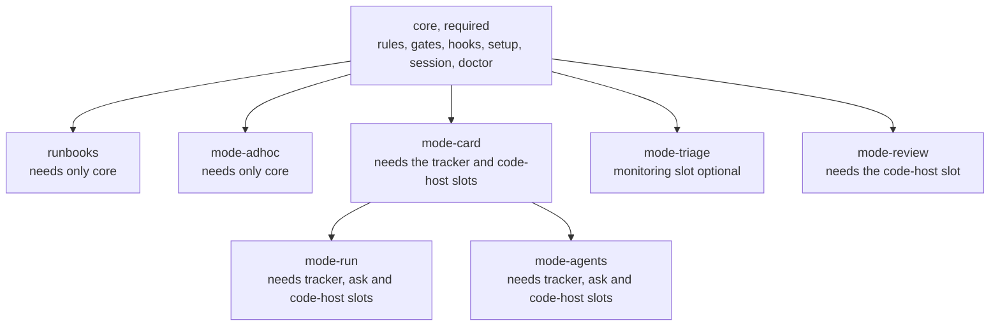

<p align="center">
  <picture>
    <source media="(prefers-color-scheme: dark)" srcset="docs/assets/logo-dark.svg">
    
  </picture>
</p>

<h1 align="center">Trampo</h1>

<p align="center"><b>A way of working with AI coding agents that your team builds, and keeps, even when people leave.</b></p>

<p align="center">
  
  
  
</p>

<p align="center">
  <a href="#get-started">Get started</a> ·
  <a href="docs/wiki/Home.md">Wiki</a> ·
  <a href="docs/wiki/How-it-works.md">How it works</a> ·
  <a href="docs/wiki/Measured-results.md">Measured results</a> ·
  <a href="ROADMAP.md">Roadmap</a>
</p>

https://github.com/user-attachments/assets/16b842ad-f842-4a27-8a7e-8e1071f94b0d

The intro video, 2 minutes 28 seconds, narrated in plain words. It tells the same story as this page, in the same
order. The full-size file is on the
[video-1 release](https://github.com/trampo-framework/trampo/releases/download/video-1/trampo-intro.mp4). Its source and rebuild command are in [extras/video/](extras/video/README.md).

Most AI tools give you pieces: a component, a plugin, a bot. None is a way of working your team builds. And what
the AI learns gets lost: in one chat, on one laptop.

Trampo is a toolbox your team builds as it needs, reusing the tools you already have. It runs inside Claude Code. It
starts small and grows into how your team already works.

## Get started

You need Claude Code, Python 3 (tested on 3.12) and git.

**1. Install.** In a terminal, add the marketplace and install three parts: the core, the card mode and runbooks.

```bash
claude plugin marketplace add trampo-framework/trampo
claude plugin install trampo-core@trampo
claude plugin install trampo-mode-card@trampo
claude plugin install trampo-runbooks@trampo
```

**2. Set up.** Make an empty folder for your team's workspace, start Claude Code in it, and run `/trampo-core:setup`.
It asks whether this is lite (one person, one project) or full (a whole team). Answer lite, and it asks three
questions, one at a time:

1. The team or workspace name.
2. The code repository you work in: the full path of its folder on this machine.
3. The approver: you. Setup reads your git user name, and asks for your name only if git has none.

It shows one summary. Type your agreement, for example "Yes, go ahead with the setup.", and it builds the workspace
and makes its first commit. Run `/trampo-core:doctor`: it should report 0 failures.

**3. Map your project.** Run `/trampo-runbooks:first-load` and name your code repository. It reads the code, runs
nothing, and drafts a playbook for each system and each main flow.

**4. Run your first task.** Run `/trampo-mode-card:card` and name a piece of work, for example "run card demo-1".
It checks the task, asks its questions once, and waits for your yes before it starts.

Then, in the [wiki](docs/wiki/Home.md):

| You are | Read |
| --- | --- |
| the tech lead mapping the first project | [Lite setup](docs/wiki/Lite-setup.md) |
| a teammate joining a project that is already set up | [Joining a workspace](docs/wiki/Adopting-it.md#joining-a-workspace-that-is-already-set-up) |
| teaching it a new playbook or skill | [Teaching it](docs/wiki/Adopting-it.md#teaching-it-a-new-playbook-or-skill) |
| setting up a whole team with the full interview | [Adopting it](docs/wiki/Adopting-it.md) |

## How it works, in plain words

1. **One person maps how the team works.** Usually the tech lead: the systems, the steps, the checks. Start with one
   project.
2. **Then the whole team works through it, every day.** Each piece of work teaches the developer and the agent at
   the same time.
3. **You give the directions.** Nothing starts until you say yes. Not done until an independent check passes.
4. **One shared memory, in plain files.** Every lesson goes into one shared place. One file becomes topics, then
   playbooks for each system. Teach it a new skill, and it shows you more of your system.
5. **It compounds.** More people using it means more knowledge, more playbooks, more fixes. Anything spotted on the
   way is recorded and sorted later. Urgent items go to a person straight away.
6. **It keeps the why.** Version control kept your code. This keeps the why: decisions, goals, how it was tested.
   Someone leaves, their knowledge stays. Someone new starts from it.

In the files, a playbook is called a runbook: what is true about one system, and numbered steps an agent can follow.

## Measured on the reference system

These numbers were measured on the workflow this framework was built from (the reference system): one team, from
2 October to 20 November 2026. They were not measured on Trampo itself, and there is no baseline from before the
team adopted the workflow.

| Measure | Change |
| --- | --- |
| Agent coverage: runbooks the agents replay, 2 Oct to 20 Nov | 3.9 times (index 100 to 391); system runbooks 2.7 times, flow runbooks 5.2 times |
| Share of card records that cite a runbook, weeks 41 to 43 against weeks 45 to 47 | about 29% to about 45% (+17 points) |
| Card records whose systems all had a system runbook, 2 Oct against the end of week 47 | about 63% to about 89% (about 6 in 10 to nearly 9 in 10); systems named with a system runbook, about 1 in 3 to about 4 in 5 |
| Card records whose systems all had a system runbook, by week end, weeks 1 to 7 of the window (weeks 41 to 47) | start 63%, then 74%, 77%, 80%, 80%, 83%, 86%, 89% |
| Card records that recorded at least one finding outside their scope, 2 Oct to 20 Nov | about 57% |
| Register entries first raised 2 Oct to 20 Nov that became a fix or planned work | about 1 in 6 (16%); about 1 in 20 recorded as fixed |
| Open dependency upgrade backlog, same scope at the first and last count | 86% smaller (index 100 to 14) |
| Review findings per review | flat |
| Median time for an unattended card to reach ready for release | about 2.3 times slower (the peak, in the second window, was about 6 times the first run) |
| Done card sessions per ISO week, week 41 to week 47 (5 Oct to 22 Nov) | 2.8 times (index 100 to 280), about 180% more |
| Share of done card sessions run by the unattended agent, weeks 41 to 43 against weeks 45 to 47 | about 70% to about 78% (+8.2 points) |
| Done card sessions with no human turn, weeks 41 to 43 against weeks 45 to 47 | about 42% to about 52% (about 4 in 10 to about half) |

A person still reviewed and approved every release. Absolute counts are left out on purpose: only the relative
change is shown.

**What we learned**

- Coverage grows one runbook at a time. Each runbook lets the agents work on and check one more system or flow,
  and the defects they met on the way were written down as found, so each one has an entry a person can decide on.
- A stricter review raised rework and lead time. That is the cost of catching more, and quality per review stayed
  flat rather than improving.
- Measure from day one. Without a before-baseline, none of these numbers can say what the workflow changed.

Bugs after release and reverts were not measured. The detail, the caveats and
the charts are in [Measured results](docs/wiki/Measured-results.md).

Each practice in the reference system began as an experiment, kept or dropped on the numbers. [How the reference
system was built](docs/wiki/How-it-was-built.md) tells that story and says which parts Trampo ships.

## Start small

After a while it runs itself: the memory, the plans and the checks all grow in one place. It is all yours: plain
files in your own git repository. Stop any time and keep everything. Start small, with one project:
[Get started](#get-started).

## The problems it answers

Teams that work with coding agents hit the same problems. Each row says what Trampo does about one, and where to
see it.

| The problem | What Trampo does | See it |
| --- | --- | --- |
| **Agents and people repeat mistakes.** What worked last time lives in someone's head. | Work runs on runbooks: what is true about each system, and numbered steps an agent can follow. Every finished piece of work writes what it learned back into them. | [Runbooks](modules/runbooks/README.md) |
| **The work keeps widening.** An agent finds a defect next to its task and starts fixing it. | Anything found outside the task is recorded in the known-issues register, or added as a sighting to the entry already there, and people triage it later. Only something urgent goes to a person at once, and it is still not fixed inside the task. | [Found on the way](docs/wiki/How-it-works.md#found-on-the-way) |
| **Tech debt is invisible.** Nobody can list what is known to be broken. | Every recorded defect has an entry and a decision: for review, accepted, declined or fixed. | [Known issues](core/seeds/memory/shared/known-issues.md) |
| **Nobody remembers why.** The decision was made in a chat that is gone. | Each session keeps a record as it goes: the decisions in the person's words, the findings with evidence, and every approval. All of it is committed to the team's repository. | [How it works](docs/wiki/How-it-works.md) |
| **Knowledge leaves with people.** A developer goes, and so does how things are done. | Memory, runbooks and session records are plain files in the team's repository, with an index that says when to read what. | [Core rules](core/constitution.md) |
| **Nobody knows if the process is helping.** | Every session is counted in a telemetry ledger, each correction becomes a lesson, and a periodic review checks whether a change helped. | [Measured results](docs/wiki/Measured-results.md) |

## Questions a team asks

**What happens when someone leaves?** What they learned while working is already in the shared repository: the
memory entries they promoted, the runbooks they wrote or corrected, and the record of every session they ran. A new
person, or a new agent, starts from the same files. Trampo has no onboarding course: a new person
[joins the workspace](docs/wiki/Adopting-it.md#joining-a-workspace-that-is-already-set-up) and starts from its files.

**How did we do this project a year ago?** Open the session record for it, or search for it. Records, memory and
incidents are plain files, so the history is `grep` and `git log`:

```bash
grep -ril 'payment retries' sessions/ memory/ incidents/
git log --follow -p sessions/<subject>/session.md
```

The record says what was done (Log), when (dated lines and commits) and why (Decisions, with the person's words).
The assistant also looks up prior work before it starts new work, and triage scores each decision against the
prior one it found.

**Who approved that?** The gate hook writes each approval to the session's ledger, and a change to the files that
set the assistant's limits needs an `Approved-by:` line tied to a recorded yes before git will push it.

**What did we decide not to fix?** The known-issues register: each entry ends in a status, and a declined one says
who declined it and why.

## The life of a piece of work


The next session, by anyone, reads what this one wrote. More in [How it works](docs/wiki/How-it-works.md).

## What ships

- [x] **Core** (`trampo-core`): rules, approval gates, hooks, session record and ledger, memory layout, setup,
  health check, retro. [Core rules](core/constitution.md)
- [x] **Runbooks** (`trampo-runbooks`): system and flow runbooks, a first load from code, replay.
  [Runbooks](modules/runbooks/README.md)
- [x] **Card mode** (`trampo-mode-card`): one work item from intake to done, with a premise check, slices built
  test first, and an independent QA verdict the close checks.
- [x] **Triage** (`trampo-mode-triage`): alarms and incidents, an index row for every triage, prior art first.
- [x] **Review** (`trampo-mode-review`): one change reviewed read-only, with evidence rules checked in code.
- [x] **Epic runs** (`trampo-mode-run`): a controller drives several cards with one worker each.
  [Controllers and agents](docs/wiki/Controllers-and-agents.md)
- [x] **Unattended agents** (`trampo-mode-agents`): card agent, agents monitor, release monitor, card triage. A
  person still releases.
- [ ] **Unattended review agent** that learns from corrections. [Roadmap](ROADMAP.md)
- [ ] **Unattended delivery for low-risk work.** [Roadmap](ROADMAP.md)

Each part installs on its own. A tracker, a chat tool, a code host and monitoring are four slots the team fills with
its own programs; until then each slot is a stub and the assistant asks a person to do that step.
[The parts](docs/wiki/The-parts.md) and [Slots and adapters](docs/wiki/Slots-and-adapters.md) say what each part
needs.



## What it does not do

- **The hooks are a check against a confused assistant, not a wall.** An ordinary rewording of a command gets past
  any hook that reads commands, so every gated action names a backstop outside the hook (a credential the assistant
  does not hold, a branch rule on the code host). Names are declared, never proven: there are no signatures.
  [Security model](docs/wiki/Security-model.md)
- **Several rules are prose only.** Opening a session at all, keeping a task list and verifying before saying
  verified are not enforced by code. Each rule in [the constitution](core/constitution.md) says what checks it.
- **The registers hold what sessions meet.** The known-issues register lists defects found during work; it does not
  scan a codebase for debt.
- **Search is files and git.** There is no search service: the history is as good as the records sessions write.
- **Other runtimes** can follow the rules, since the workspace is plain markdown with an `AGENTS.md` at its root,
  but they get none of the hooks.

## Status

Status: 0.5.0. The core, the person-run modes, epic runs, unattended agents and review, with a mock for each slot.
Not yet published. Changes per version: [CHANGELOG.md](CHANGELOG.md). Planned next: [ROADMAP.md](ROADMAP.md).

After an upgrade, update the marketplace, then each plugin you installed, then start a new session:

```bash
claude plugin marketplace update
claude plugin update trampo-core@trampo
```

Repeat the last line for each part. `doctor` fails while the workspace pins a `core_version` other than the
installed core.

## Pages

| Page | What it answers |
| --- | --- |
| [Lite setup](docs/wiki/Lite-setup.md) | the tech lead maps the first project: the core, the card mode, runbooks and a first card |
| [Home](docs/wiki/Home.md) | where everything is |
| [How it works](docs/wiki/How-it-works.md) | the life of a piece of work, end to end |
| [The parts](docs/wiki/The-parts.md) | what each part adds and needs, and how to take only some |
| [Adopting it](docs/wiki/Adopting-it.md) | a whole team from nothing, joining a workspace, teaching it more |
| [Controllers and agents](docs/wiki/Controllers-and-agents.md) | an epic run and unattended agents |
| [Security model](docs/wiki/Security-model.md) | who approves, what is gated, and the known limits |
| [Several teams](docs/wiki/Several-teams.md) | more than one team on the same product, and what scale means here |
| [Measured results](docs/wiki/Measured-results.md) | what was measured on the reference system, with its caveats |
| [How it was built](docs/wiki/How-it-was-built.md) | how each practice was tried, and kept or dropped on the numbers |
| [Slots and adapters](docs/wiki/Slots-and-adapters.md) | the four slots and how a team fills one |

The reference docs: `core/constitution.md` (the core rules, each with what checks it), `core/protocols/`
(`read.md`, `write.md`, `gates.md`, `slots.md`), `docs/parts.md`, `docs/agents.md`, `docs/principles.md`,
`docs/writing-a-module.md`, `docs/decisions.md` and `docs/runtime-findings.md`. To contribute, read
[CONTRIBUTING.md](CONTRIBUTING.md).

## Licence

Apache-2.0. See `LICENSE` and `NOTICE`.
