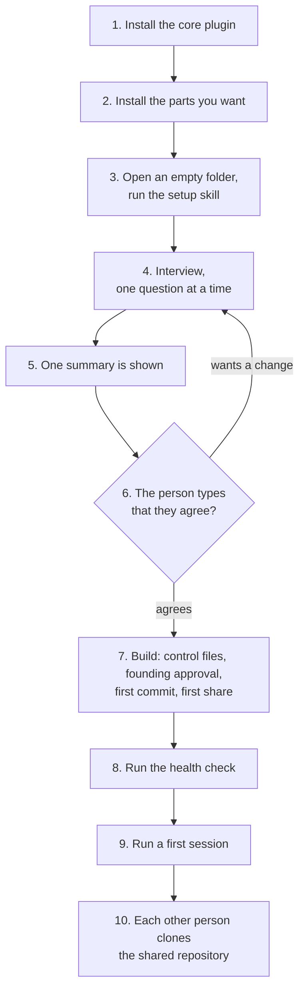
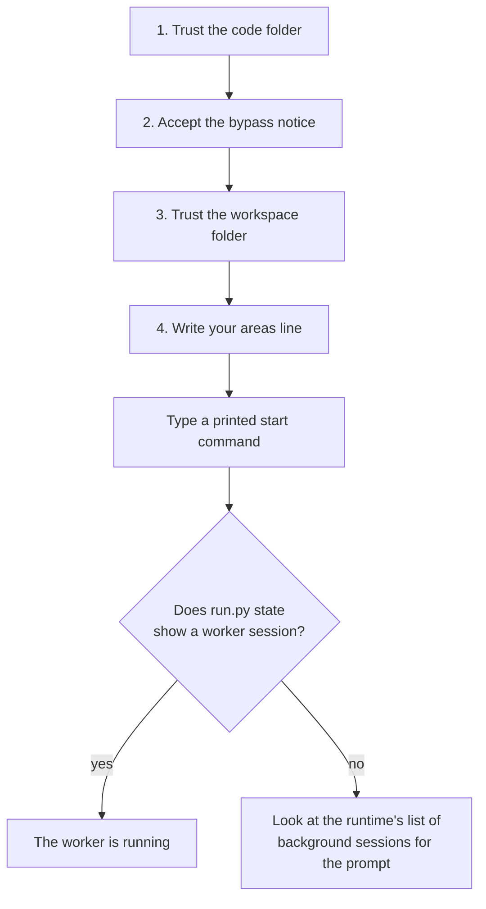

# Adopting it

A path for a new team, from nothing to a first session. The commands are for Claude Code. The sources are
`README.md`, `core/skills/setup/SKILL.md` and `docs/agents.md`.

One person on their own can take the lite setup instead (card mode and runbooks, three questions): see
[Lite setup](Lite-setup.md).

## Before you start

- Python 3, tested on 3.12.
- For `storage: git`: a recent git (the scripts use worktrees and `rev-parse --path-format`), and ideally a shared
  repository that exists and has no branch yet.
- One person who will be an approver and who runs setup.

## From nothing to a first session

The diagram answers: what are the steps, and where does a person have to agree?



1. **Install the core.** Add the marketplace and install the core:

   ```bash
   claude plugin marketplace add trampo-framework/trampo
   claude plugin install trampo-core@trampo
   ```

2. **Install the parts you want.** See [The parts](The-parts.md) for what each needs. For example:

   ```bash
   claude plugin install trampo-mode-adhoc@trampo
   ```

3. **Open an empty folder and run `/trampo-core:setup`.** Setup refuses if `workspace.yaml` already exists.

4. **Answer the interview.** One question at a time, each with a recommended answer. It covers:
   - the team and its code repositories
   - storage: `git` (recommended) or `files`, for a team with no git on a shared folder. Never both
   - who is at the keyboard, and who the approvers are
   - which installed modes to start with
   - which actions are gated, and the backstop outside the hook for each
   - whether the team's changes pass a review before they take effect
   - whether direct pushes to the team branch are refused on the code host
   - the four slots: setup copies a stub into each. Fill one later, or choose the mock for a trial
   - the periodic review, the size prompts, the team's own rules, and the shared repository's address

5. **Read the summary.** Setup shows one summary of what the control files will say.

6. **Type your agreement.** The person running setup must be one of the approvers the summary names.

7. **Setup builds the workspace.** It writes the control files, records the agreement in the ledger as the
   founding approval, and on git makes the first commit and the first share. Nobody types a git command or edits a
   file by hand. This works once. After that a control file changes only on an approver's yes.

   If the first share did not go through, setup says what a person has to arrange (an address, an empty
   repository, access).

8. **Run `/trampo-core:doctor`.** It must report no failures. Read its warnings. Each gate with no backstop is
   one.

9. **Run a first session.** For example `/trampo-mode-adhoc:adhoc`. With the runbooks part installed and code
   repositories named, the first thing to run is `/trampo-runbooks:first-load`.

10. **Bring in the rest of the team.** Each other person gets their own copy from the shared address:
    [Joining a workspace](#joining-a-workspace-that-is-already-set-up). On git the next session start installs
    git's hooks inside the workspace repository's own `.git/hooks` folder. Nothing outside the repository is
    written. [Security model](Security-model.md) says exactly what the install does.

## What the workspace holds after setup

```
AGENTS.md  CLAUDE.md     the working rules, loaded at every turn
workspace.yaml           settings: storage, approvers, gated commands, backstops, caps, hook modes
constitution.md          the team's own rules, added to the core's
memory.md                index of indexes: one row per category, with read triggers
memory/shared|dev|support|review/   one index per category, one file per subject
modes/<mode>.md          each mode's working instructions; the team edits them directly
slots/<slot>             the team's programs for tracker, ask, code-host, monitoring
sessions/<subject>/      the record of an ad-hoc or card session, with its evidence
incidents/               index.md, decisions.md, and one folder per investigated incident
people/<name>.md         one person's preferences
telemetry/events/        one ledger file per session, written by the scripts and hooks
```

## Joining a workspace that is already set up

Someone on your team ran setup and shared the workspace. You join it; you do not run setup again (it refuses where
a workspace already exists).

1. **Install the same parts.** The workspace's `modes:` list in `workspace.yaml` says which modes it uses, and a
   `runbooks/` folder means the runbooks part. Add the marketplace and install each, for example:

   ```bash
   claude plugin marketplace add trampo-framework/trampo
   claude plugin install trampo-core@trampo
   claude plugin install trampo-mode-card@trampo
   claude plugin install trampo-runbooks@trampo
   ```

   Install the version the workspace pins as `core_version`: `doctor` fails otherwise.

2. **Get your own copy.** Clone the workspace from the address the person who set it up gives you:
   `git clone <workspace address>`. Your git user name (`git config user.name`) is who you are in the workspace.
3. **List your code folders.** If `workspace.yaml` says `outside: ask-first` (lite always does), a change outside the
   workspace waits for an approver unless it is in one of your folders. Write each folder where your copies of the
   team's code live, one full path per line, in `~/.config/trampo/areas` (or `$XDG_CONFIG_HOME/trampo/areas`). You
   write it by hand; a session's write to it is refused.
4. **Open it.** Start Claude Code in the workspace folder. The first session start installs git's hooks in the
   workspace repository's own `.git/hooks` folder and nowhere else. Run `/trampo-core:doctor`: it reports
   `0 failures`.
5. **Start work.** `/trampo-mode-card:card` for a piece of work, or `/trampo-mode-adhoc:adhoc` when that mode is
   installed. Every session reads the memory and the playbooks the team already wrote, and adds to them when it
   closes.

You can do the work without being an approver. To say yes to gated actions yourself, an approver adds your name
under `approvers:` in `workspace.yaml`; that file is a control file, so the change waits for an approver's yes.

## Teaching it a new playbook or skill

- **A playbook for another system.** Run `/trampo-runbooks:first-load` again and name the new repository or
  document folder. It drafts a system runbook and its flows, and the list of questions reading did not settle.
- **What a piece of work learns.** Nothing extra to run: a card's close writes the system facts it learned into
  `runbooks/systems/<system>.md` or `runbooks/flows/<flow>.md`, and each correction a person made becomes a memory
  entry under `memory/`.
- **Checking a playbook is true.** Replay runs a flow from the file alone on the team's test environment, and only
  that marks it verified. It is off until an approver adds the test environment to `workspace.yaml`; then run
  `/trampo-runbooks:replay`. See `modules/runbooks/README.md`.
- **A new skill.** The first load suggests skills in `sessions/first-load/skills.md` and drafts each one as
  `proposals/skill-<name>.md`. A skill is added only when an approver names it ("Yes, add skills/<name>"); it is then
  written to `.claude/skills/<name>/SKILL.md` in the workspace, and it reaches
  teammates with the rest of the workspace when the session shares its files.

## One-time steps before a background worker can start

You need these only for an epic run or an unattended agent, where a worker starts in the background. A person-run
session does not need them.

The diagram answers: what must a person do by hand, once per machine, before a worker can start?



Each step is done once per machine by the person whose machine it is, at their own terminal. No session and no
agent does any of them for the person. A background start stops at each one that is missing, with nobody there to
see the prompt.

1. **Trust the code folder.** Start the runtime in the code repository once and accept its trust prompt. Missing,
   the start says "Added folder not trusted".
2. **Accept the bypass notice.** The printed command starts the worker with `--permission-mode bypassPermissions`,
   and the runtime shows a one-time warning for that mode. Start the runtime once with that mode, read the warning
   and accept it. The worker's sandbox file, which dispatch writes, is what limits it after that.
3. **Trust the workspace folder.** Start the runtime in the workspace folder once and accept its trust prompt.
   Missing, the start says "Workspace not trusted".
4. **Write your areas line.** The file `areas` in the product's folder under your own config folder
   (`$XDG_CONFIG_HOME/trampo/areas`, or `~/.config/trampo/areas` when that variable is not set) lists, one full
   path per line, the folders where your copies of the team's code live. You write it by hand. A session's write to
   it is refused, because it says where a session may work.

After typing a printed start command, run `run.py state`. An item reads "start command printed, no worker session
has opened for it" until the worker has opened its session.

## Upgrading later

An installed plugin can keep running an older copy after its source has moved on. After every upgrade update the
marketplace, then each plugin you installed by name, then start a new session:

```bash
claude plugin marketplace update
claude plugin update trampo-core@trampo
claude plugin update trampo-mode-adhoc@trampo
```

Repeat the last line once for each part you installed. The `name@trampo` spelling follows the install command.
The update command has not been run with it yet.

Unless a changelog entry says more, upgrading means setting `core_version` in `workspace.yaml` to the new version.
That file is a control file, so the change waits for an approver. From 0.4.6 an approver names a control folder by
its path with the slash ("Yes, change slots/"), or by the path of the file being changed. The word "slots" alone
no longer opens anything. `doctor` fails while the workspace pins a
`core_version` other than the installed core.

Next: [Controllers and agents](Controllers-and-agents.md).
