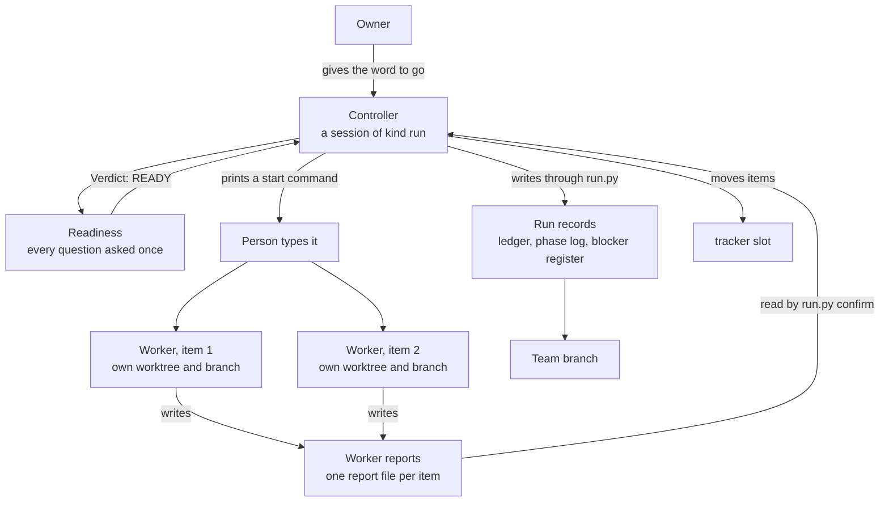
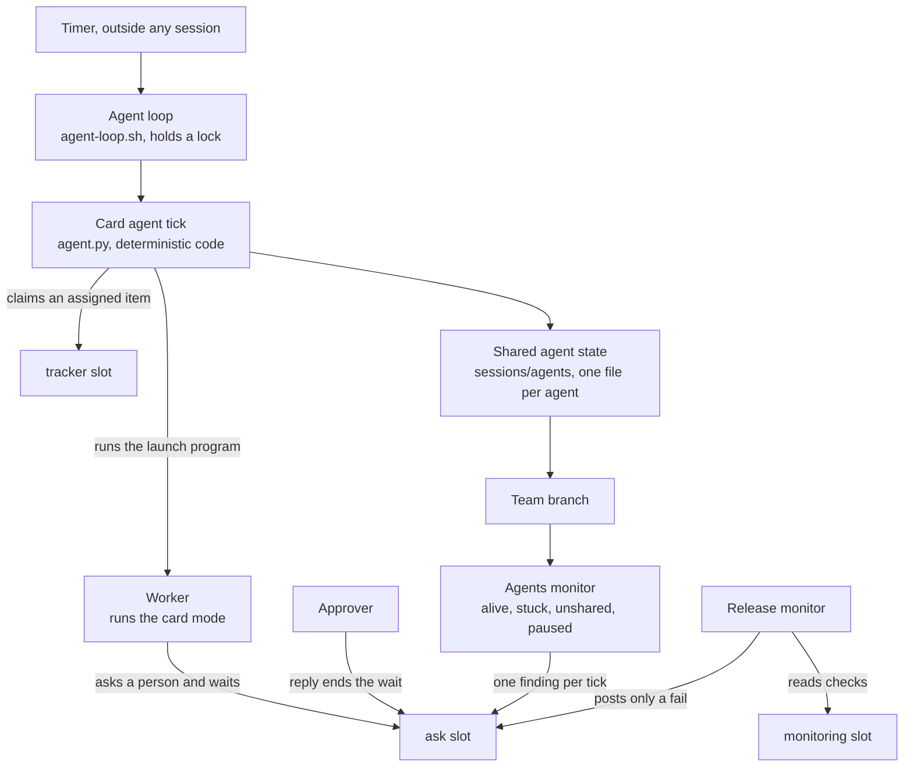

# Controllers and agents

Two parts let work run without a person driving each step: `mode-run` (an epic run, a controller with workers) and
`mode-agents` (unattended agents on a timer). This page is a summary. The full steps, with every command, are in
`docs/agents.md`. Every step can run against the mock adapters first, when the team chose the mock at setup, so
it can see the whole loop before it connects a real tracker or chat.

## An epic run

The diagram answers: in an epic run, who starts what, and where is the state kept?

Setting it up:

1. Install `mode-run`. Open a session of kind `run` named for the epic.
2. Create the items in the tracker with their `needs:` links.
3. Run the readiness skill. It looks facts up, proves capabilities with read-only checks, asks every remaining
   question once with a default, and writes `sessions/<run>/readiness.md` with `Verdict: READY` on its first line.
   A worker cannot start without that verdict.
4. `python3 core/scripts/run.py --ws . --run <run> plan <items>` prints the steps. Show them to the owner and wait
   for the word to go.
5. List the code repository under `repositories:` in `workspace.yaml`. Dispatch refuses any other folder.
6. For each free item: make a worktree and branch, write the brief from `templates/brief.md`, then
   `run.py dispatch <item> --brief <file> --worktree <dir>`. Type the command it prints. Record the move with
   `run.py write`.
7. Each tick: `run.py state`, read reports, `run.py confirm <item>` when a worker reports, `run.py follow` to move
   the tracker, share with `sync.py`.

Before the first worker, each person does the four one-time steps in [Adopting it](Adopting-it.md).

What a person still does in an epic run:

- answers the readiness questions, once
- gives the word to go after seeing the plan
- types each printed start command
- says yes to every gated action
- merges and approves on the code host. These are not slot verbs: a person does them

## Unattended agents

The diagram answers: how does an agent run with nobody at the keyboard, and how does the team see it?

The agents:

| Agent | What it does | What it never does |
| --- | --- | --- |
| Card agent | works `open` and `in progress` items assigned to it, with the card mode's rules | merge, approve, release, create an item, or move an item to `done`. It stops at `ready for release` |
| Agents monitor | checks each watched agent is alive, moving, tidy and unpaused. Posts one finding per tick, the highest it has not posted in the last day. Each finding is posted at most once a day | edit an agent's definition on its own |
| Release monitor | after an item is done, reads the checks of the listed systems and records a verdict. No checks reported counts as failing | post anything but a failing verdict |
| Card triage | drafts small items and shows the drafts | create an item without a recorded approval |

Setting up the card agent:

1. In its own clone, set the git user name to the agent's name.
2. Write `agents/<name>.yaml` (kind, assignee, cap, interval, launch) and a `launch` program that starts one worker
   for an item. These are control files: an approver says yes to them. `docs/agents.md` has an example launch
   program and worker prompt.
3. Assign an item to the agent (`tracker assign <id> <agent>`). With the agents mode's gates in place this waits
   for an approver's yes, as creating an item does. Run `python3 core/scripts/agent.py --ws . tick <name>`.
4. Install the timer. It runs `modules/mode-agents/loop/agent-loop.sh <workspace> <verb> <name>`. Pause with
   `agent.py pause <name>`, resume with `resume`.
5. Sync the agent's clone on a timer of its own: `python3 core/scripts/sync.py <workspace>`. A tick runs
   `sync.py` itself only when the agent's state changed, and once an hour for its beat. An idle tick in between
   does not, so without the timer a new or changed definition can wait up to an hour.

For a monitor, write `agents/<name>.yaml` with `kind: monitor` and `watches:`, or `kind: release` with `systems:`.
To try one without telling anyone, add `--dry-run`: `agent.py --ws . monitor <name> --dry-run`. The card agent's
tick has no trial form.

What a person still does with unattended agents:

- approves each agent definition, launch program and worker prompt, and every later change to them
- approves creating an item and assigning one to an agent
- answers what a waiting worker asked. Only a reply from someone on the approver list ends the wait
- releases. The card agent leaves `ready for release` for a person
- installs and keeps the timer

## The shared state

- **Run records.** One run ledger, one phase log and one blocker register per run: `sessions/<run>/run-ledger.md`,
  `phase-log.md` and `blockers.md`, beside `readiness.md`.
- **A worker's report.** The worker writes `sessions/<item>/report.md`. `run.py confirm` reads it. The controller,
  not the worker, writes the run records, through `run.py`.
- **Agent state.** Each tick writes the agent's pool, waits, pause and last beat to `sessions/agents/<name>.json`
  and shares it: one commit when something changed, none when nothing did. An idle agent shares its beat once an
  hour. The gate hook refuses a session's edit of these files, so they change through `agent.py`. That refusal is a
  guard that reads commands, not a wall.
- **Tracker state words.** The scripts read five words from the tracker slot, exactly as written: `open`,
  `in progress`, `in review`, `ready for release`, `done`. A tracker with other words maps them in the slot
  program.

## Limits

- An agent is never an approver. The health check fails a name that is both.
- An unattended agent has no person to ask, so the backstop matters most here: a credential its account does not
  hold, or the other system's own approval step.
- A worker loads the hooks only if the plugin is enabled for its session. The printed start command names the core
  plugin's folder for that reason. `run.py state` says per worker whether the gate hook was seen.
- Sub-agents a worker starts are not known to load hooks.
- The tick has no real runtime in its tests. A fake launch program stands in.
- The mock's branch rule is a model of a code host's, not a copy of one.

Next: [Security model](Security-model.md).
