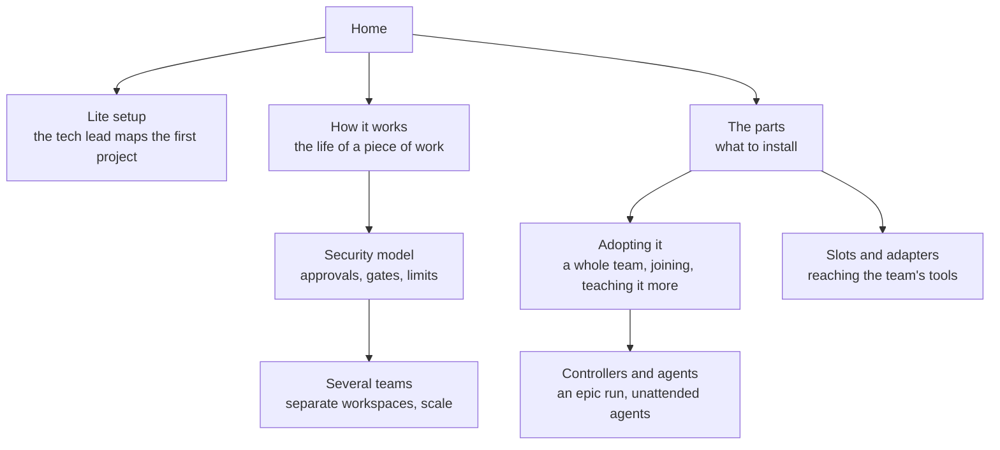

# Trampo pages

Trampo is a toolbox your team builds as it needs, reusing the tools you already have. It runs inside Claude Code,
starts small with one project, and grows into how your team already works. These pages explain it with diagrams.
Status: early, first public release.

## Start here

| You are | Start with |
| --- | --- |
| the tech lead mapping the first project | [Lite setup](Lite-setup.md): install, three setup questions, the first load, a first card |
| a teammate joining a project that is already set up | [Joining a workspace](Adopting-it.md#joining-a-workspace-that-is-already-set-up) |
| teaching it a new playbook or skill | [Teaching it](Adopting-it.md#teaching-it-a-new-playbook-or-skill) |
| setting up a whole team with the full interview | [Adopting it](Adopting-it.md) |

The short version, with every command, is "Get started" in the [README](../../README.md#get-started).

## Video

A 2 minute 28 second narrated [intro video](https://github.com/trampo-framework/trampo/releases/download/video-1/trampo-intro.mp4) shows the idea before you read the pages. It is built from
[extras/video/](../../extras/video/README.md) in the repository.

## The map

The diagram answers: which page do I read for which question? Start with Lite setup.

| Page | Read it when |
| --- | --- |
| [Lite setup](Lite-setup.md) | you are mapping the first project: one person, the core, the card mode and runbooks, a first card |
| [How it works](How-it-works.md) | you want to see one piece of work from the ask to the shared result |
| [The parts](The-parts.md) | you are choosing what to install |
| [Adopting it](Adopting-it.md) | you are setting up a new team, joining a workspace, or teaching it more |
| [Controllers and agents](Controllers-and-agents.md) | you want work to run in parallel, or with nobody at the keyboard |
| [Security model](Security-model.md) | you need to know who can approve what, and what the checks do not stop |
| [Slots and adapters](Slots-and-adapters.md) | you are connecting a tracker, a chat tool, a code host or monitoring |
| [Several teams](Several-teams.md) | more than one team will use the product |
| [Measured results](Measured-results.md) | you want the relative changes measured on the reference system (agent coverage, quality found on the way, throughput), and their limits |
| [How the reference system was built](How-it-was-built.md) | you want the story behind the framework, and which parts Trampo ships |

## Words used on every page

| Word | Meaning |
| --- | --- |
| Product | Trampo itself: the core and the parts, installed as plugins |
| Core | the required part: rules, gates, hooks, the session record, setup and the health check |
| Part | something a team installs beside the core: runbooks or a mode |
| Workspace | the team's own repository of plain markdown: memory, sessions, runbooks, settings, slots |
| Team branch | the shared copy of the workspace that every clone syncs with |
| Session | one piece of work, with a record and a ledger |
| Ledger | one append-only event file per session, written by the scripts and hooks |
| Approver | a person the team listed as able to say yes to a gated action |
| Gate | a check that makes a listed action wait for an approver's yes |
| Backstop | the control outside the hook that really stops a gated action |
| Slot | a named place the team fills with its own program: tracker, ask, code-host, monitoring |
| Adapter | the team's program in a slot |
| The reference system | the working practice of the real team this product was built from |

## What is in the repository

- `core/constitution.md`: the core rules, each with what checks it.
- `core/seeds/`: the workspace a team starts from, including the `AGENTS.md` an assistant reads at every turn.
- `core/protocols/`: `read.md`, `write.md`, `gates.md`, `slots.md`.
- `core/skills/`: `setup`, `session`, `retro`, `doctor`, `propose`.
- `core/hooks/hooks.json` and `core/scripts/hooks.py`: the gate, the prompt counter, the start steps, the two stop
  checks.
- `core/scripts/`: `event.py` (the ledger and, on shared folders, the journal), `approval.py` (how a yes is read),
  `prepush.py` (the boundary on git), `sync.py`, `slot.py`, `doctor.py`, `memory_review.py`, `untrusted.py`.
- `modules/`: the parts a team adds to the core.
- `docs/`: decisions, principles, how to write a module, runtime findings, agents, parts.
