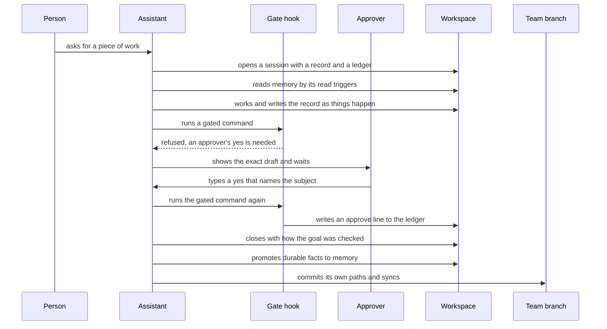
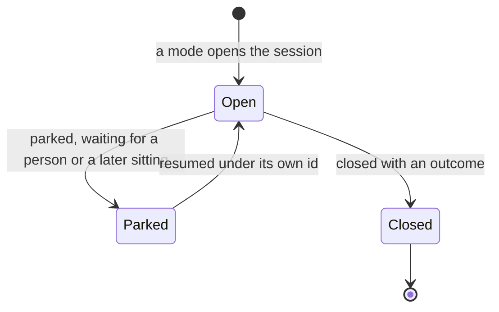
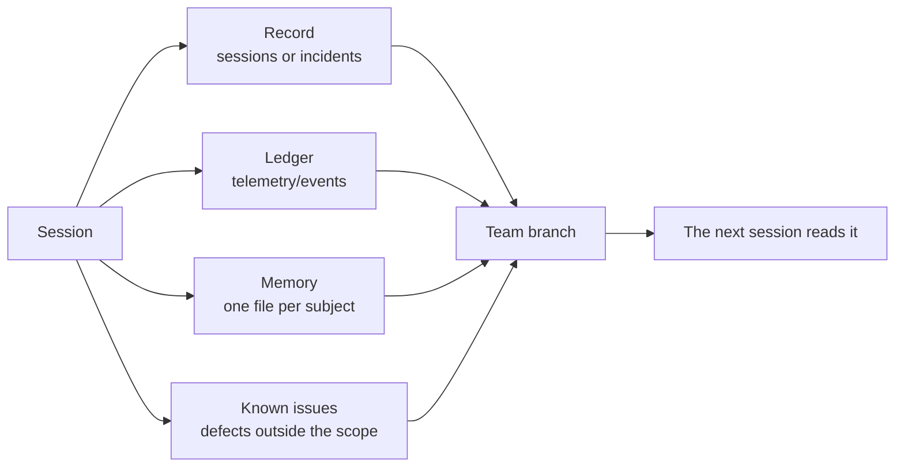
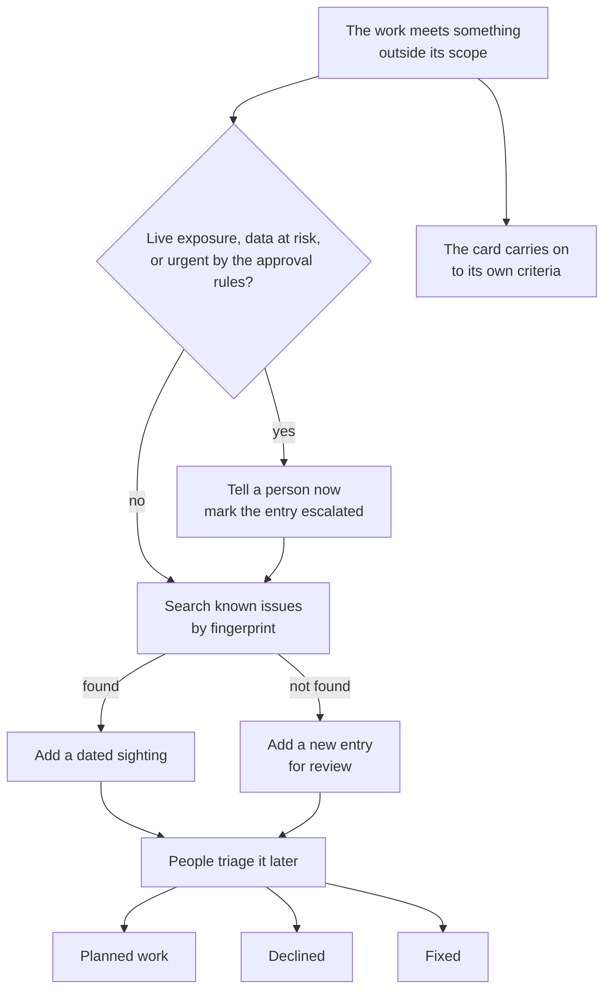

# How it works

This page follows one piece of work from the ask to the shared result. The rules behind each step are in
`core/constitution.md`, and the detail is in `core/protocols/`.

## The life of a piece of work

The diagram answers: who does what, in what order, when a piece of work includes one gated action?

The same steps in words:

1. **Ask.** A person asks for work. A mode (ad-hoc session, card session, triage, review) says how that kind of
   work runs.
2. **Open.** The mode opens a session before it works. The session has a record at `sessions/<subject>/session.md`
   and a ledger at `telemetry/events/<sid>.jsonl`.
3. **Read.** At every start a hook says the memory routes and the gate rules. The assistant opens a memory file
   when its read trigger fires. Prior work is looked up before new work starts.
4. **Work.** The record is written as things happen. Every prompt that reaches an open session is counted by a
   hook as one touch.
5. **Gate.** A command the team listed as gated, or a change to a control file, waits for a person. The rule is:
   draft, show, wait.
6. **Approval.** The gate opens on an approver's own typed yes naming the subject, on their bare yes through the
   ask slot, or on a standing grant. The hook writes the yes to the ledger. A yes with a condition is a new
   question. An unanswered ask is a no.
7. **Close.** A session ends `done` only with how the goal was checked. A card session also needs a QA verdict:
   the close reads the last `Verdict:` line of `sessions/<card>/qa-report.md` and refuses a done close unless it
   is `Verdict: PASS`, or a recorded skip (`Verdict: SKIPPED: <reason>`, no local path to test) that an approver
   said yes to closing, naming the card. That is a read of one line in a file the assistant can write. It reminds a session that
   skipped QA; it cannot tell whether QA really ran or whether the helper that ran it was independent. Each prompt from a person that changed
   the work gets a cause, and each cause yields a memory change or a stated "no durable lesson". A card session
   also writes the system facts it learned into the system or flow runbook, and puts a `runbook:` line in its
   record: the paths changed, `none learned`, or `left in <where>` in a workspace without the runbooks part.
   Closing a card as done with no `runbook:` line prints a warning and still closes. The close is refused only
   when the line names a runbook that does not exist. The check cannot tell whether the facts are really in the
   runbook.
8. **Share.** On git the session commits only the paths it wrote and shares them with `core/scripts/sync.py`.

## The states of a session

The diagram answers: what states can a session be in, and how does it move between them?

A parked session stays open and is resumed under its own id. On a resume the assistant reads the record from the
team branch and restates its Next, Open and Decisions. A recorded decision is not asked again.

## Where things are written

The diagram answers: where does each kind of output of a session end up?

- **Memory.** One fact, one entry, one file, dated, ending with a "How to apply" line. A claim about live state
  carries an "As of" line with the command that re-checks it.
- **A defect outside the scope** is recorded, not acted on. See "Found on the way" below.
- **No real user data** goes in the workspace. Documents, archives, screenshots and recordings stay out of git by
  default.

## Found on the way

A card stays on its acceptance criteria. When the work meets something else on the way, such as a security concern
while building an unrelated feature, it neither stops nor widens the card. It records the finding and carries on.
The diagram answers: what happens to a finding outside the card's scope?

- **The register** is `memory/shared/known-issues.md`. Other sessions and agents read it, so a repeat becomes a
  sighting on the same entry, found by its typed fingerprint, and never a second entry.
- **People decide** from its For review list, in their own triage, not inside the card. A later check that meets the
  same thing confirms whether the decision covered it.
- **The one exception** is urgency: a live exposure, data at risk, or what the team's approval rules call urgent is
  told to a person straight away and marked `escalated (<to whom, when>)`. It is still not fixed inside the card.
- **The result:** cards do not inflate, and nothing found is lost.

## Sharing a git workspace

Each person works in their own clone. A session commits only the paths it wrote and shares them through
`core/scripts/sync.py`, which replays local commits onto the team branch in a throwaway worktree. The checkout
itself is never pulled, stashed or rebased.

The stop hook holds a turn that leaves its own files, its session ledger or a file one of its shell commands wrote
uncommitted or unshared, and names each. A session start syncs in the background and installs git's hooks in the workspace
repository's own `.git/hooks` folder: `pre-push` and `prepare-commit-msg`. A hook already there is renamed to
`<name>.next` and still runs. Nothing outside the repository is written. The `pre-push` hook is the one check that
refuses when it cannot tell: a control-file change needs an `Approved-by:` line tied to a recorded yes.

## What is checked by code and what is not

Each rule in `core/constitution.md` says what checks it: a hook, a script, or nothing but the text. Several rules
are prose only. For example, opening a session at all, keeping a task list, and verifying before saying verified
are not enforced by code. Read [Security model](Security-model.md) for what the hooks stop and what they do not.

Next: [The parts](The-parts.md).
