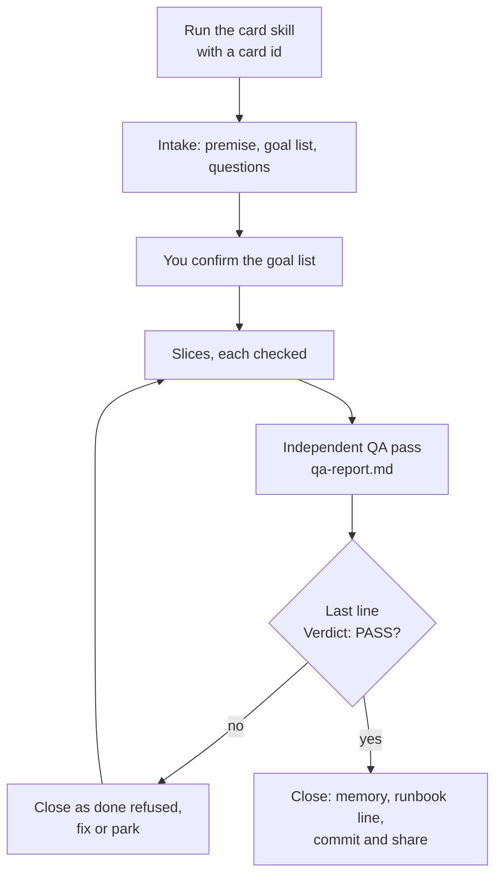

# Lite setup: map your first project

This is where Trampo starts: one person, usually the tech lead, maps how the team works on one project (its
systems, steps and checks) and runs a first piece of work through it. The lite version is the core, the card mode
and the runbooks part. When it works for you, the rest of the team
[joins the workspace](Adopting-it.md#joining-a-workspace-that-is-already-set-up).

This path was run end to end on a demo booking app on 2026-11-25.

## What you get, and what you do not

You get setup, the session record, approval gates, memory, runbooks drafted from your code, and the card loop:
intake, slices, QA, and a close that writes what was learned.

You do not get:

- **Other modes.** See [The parts](The-parts.md).
- **Epic runs and unattended agents.** See [Controllers and agents](Controllers-and-agents.md).
- **Real tools.** Slots stay stubs, so you do the tracker and code-host steps by hand. See
  [Slots and adapters](Slots-and-adapters.md).

## Set it up

You need Python 3 (tested on 3.12), a recent git and Claude Code. In a terminal:

```bash
claude plugin marketplace add trampo-framework/trampo
claude plugin install trampo-core@trampo
claude plugin install trampo-mode-card@trampo
claude plugin install trampo-runbooks@trampo
```

Make an empty folder for the workspace, start Claude Code in it (a new session, so the plugins load), and run
`/trampo-core:setup`. It asks first: lite or full. Answer lite, then three
questions, one at a time:

1. The team or workspace name.
2. The code repository you work in: the full path of its folder on this machine (or several).
3. The approver: you. Setup reads your git user name, and asks for your name only if git has none.

Setup sets the rest: storage `git`, the card mode, a change outside the workspace waits for your yes, your
repository folders go into your own `areas` file so edits there go ahead, no gated commands, slots stay stubs, and
the review and size defaults. These match the full interview's recommended answers for one person. To change any of
it, choose full instead.

Read the one summary and type your agreement, for example "Yes, go ahead with the setup." Setup builds the
workspace and makes its first commit. It also writes your repository folder into your own `areas` file
(`~/.config/trampo/areas`). Run `/trampo-core:doctor`: it reports `0 failures`.

The workspace now holds `workspace.yaml`, `constitution.md`, `AGENTS.md` and `CLAUDE.md`, `memory.md` and
`memory/`, `modes/card.md`, `modes/runbooks.md`, `runbooks/README.md`, the four slot stubs under `slots/`, and the
setup session's ledger under `telemetry/events/`. It is saved in git on this machine only. To share it with the
team, make an empty repository on your code host and give the assistant its address; it shares the workspace, and
nobody types a git command.

## Map the project

Run `/trampo-runbooks:first-load`, naming your repository. It reads the code, runs nothing, and drafts one
playbook (a system runbook) per system in `runbooks/systems/` and one per main flow in `runbooks/flows/`. It leaves
two lists for you: `sessions/first-load/questions.md` (what reading the code did not settle) and
`sessions/first-load/unblock-list.md` (the access a replay would need). Every draft says it is a draft until a
replay has run it.

## Your first card

The diagram answers: where can one card stop?



1. Run `/trampo-mode-card:card` and name the card, for example "run card demo-1". Paste the card's text when
   asked.
2. It opens `sessions/demo-1/session.md`, checks the card's claims, cuts slices and asks its questions once.
   Confirm the goal list.
3. A helper builds each slice test first; another checks it.
4. An independent QA helper appends a pass to `sessions/demo-1/qa-report.md` and ends it with one line:
   `Verdict: PASS`, `Verdict: FAIL` or `Verdict: CANNOT-VERIFY`.
5. Closing as done is refused unless the last verdict is PASS. With no local path to test, QA is recorded as
   `Verdict: SKIPPED: no local path, <reason>`, and the close then waits for your yes, for example "Yes, close
   demo-1 as done without QA". It catches a forgotten QA step, not a dishonest one.
6. At close each correction becomes a memory entry or "no durable lesson". System facts go into
   `runbooks/systems/<system>.md` or `runbooks/flows/<flow>.md`, and the record gets `runbook: <paths changed>` or
   `runbook: none learned`. A line naming a missing runbook stops the close.
7. The session commits and shares its own files.

## Growing from lite

Bring in your teammates: [Joining a workspace](Adopting-it.md#joining-a-workspace-that-is-already-set-up). Teach it
more: [Teaching it a new playbook or skill](Adopting-it.md#teaching-it-a-new-playbook-or-skill). Set up a whole team
with the full interview: [Adopting it](Adopting-it.md). Add parts: [The parts](The-parts.md). Parallel or unattended work:
[Controllers and agents](Controllers-and-agents.md).
