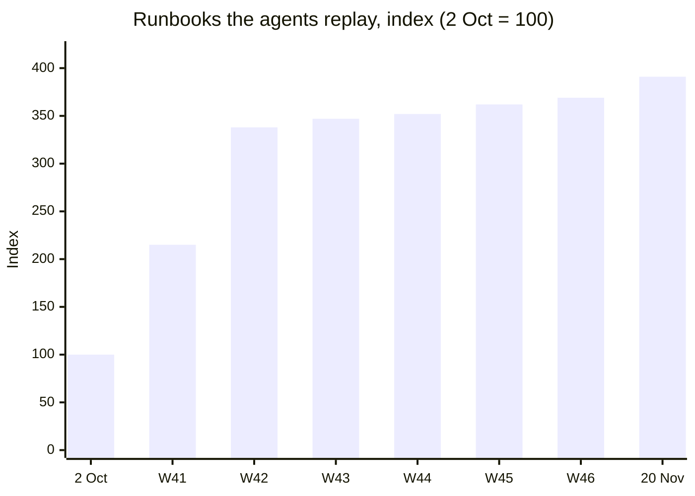
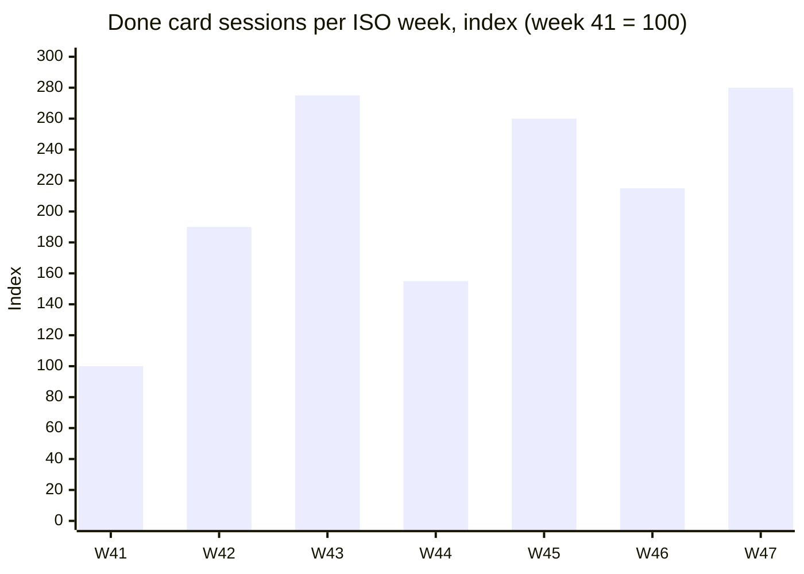

# Measured results

Every number on this page was measured on the workflow this framework was built from (the reference system): one
team, from 2 October to 20 November 2026. None was measured on Trampo itself. There is no baseline from before
the team adopted the workflow, so a number here shows what happened during the period, not what the workflow
caused.

Only relative change is shown: the team's scale is left out on purpose. The team's work items are called cards
below.

## Agent coverage: runbooks the agents replay

A runbook says how to work on and check one system (a system runbook) or one user journey across systems (a flow
runbook). The agents replay them in QA, so the runbook count is how much of the reference system they can work on
and check. The chart answers: how did that count grow, indexed so that 2 October is 100?

| Measure | Change |
| --- | --- |
| All runbooks, 2 Oct to 20 Nov | 3.9 times (index 100 to 391) |
| System runbooks | 2.7 times |
| Flow runbooks | 5.2 times |
| Card records whose systems all had a system runbook, 2 Oct against the end of week 47 | about 63% to about 89% (about 6 in 10 to nearly 9 in 10) |
| Card records whose systems all had a system runbook, by week end, weeks 1 to 7 of the window (weeks 41 to 47) | start 63%, then 74%, 77%, 80%, 80%, 83%, 86%, 89% |
| Systems named by card records that had a system runbook, same points | about 1 in 3 to about 4 in 5 (33% to 80%) |
| Share of card records that cite a runbook, weeks 41 to 43 against weeks 45 to 47 | about 29% to about 45% (+17 points) |

Definitions, all from the workspace's git history:

- A runbook is a markdown file directly under the system or flow runbook directory, counted at the last commit
  before each point. The weekly bars are read at the end of each ISO week; the last one at the end of 20 November.
- A card record is a card's `session.md`, in the ISO week of the commit that added it. It cites a runbook when its
  text at the end of the window names a runbook file. The share is over three-week blocks.
- A card record's systems are the repos in its `Repo` header row. A repo has a system runbook when a file in the
  system runbook directory is named after it, or that directory's README index names it as a backing repo. The
  system coverage share is over all the window's card records, read at the start and at the end of week 47; about
  91% of the records name a repo.

Caveats:

- Most of the growth came in weeks 41 and 42. After that coverage grew a little each week.
- A runbook counts once it exists. How complete each one is was not measured.
- Citing a runbook is not proof that QA replayed every step of it.

To reproduce the agent coverage figures: `python3 extras/figures/coverage-figures.py <workspace> --ref <branch> --runbooks
<system runbook dir> <flow runbook dir> --sessions <sessions dir> --systems <system runbook dir>`. It prints only the
relative figures above.

## Found on the way

A card stays on its acceptance criteria. When the work met something outside its scope, the agents and people
recorded it in a register for a person to decide on, as a new entry or as a sighting on an existing one, and did not
fix it inside the card ([how it works](How-it-works.md#found-on-the-way)).

| Measure, 2 Oct to 20 Nov | Share |
| --- | --- |
| Card records that recorded at least one finding outside their scope | about 57% |
| Findings that were a sighting on an entry already in the register | about 45% |
| Register entries first raised in the window that became a fix or planned work, as recorded on 26 Nov | about 1 in 6 (16%); about 1 in 20 recorded as fixed |

Definitions, all from the workspace's git history at the end of the window:

- A card record is a card's `session.md` first added in the window, as above. It recorded a finding when its card
  key is named at the head of a sighting line dated in the window, in any of the out-of-scope registers.
- A finding is a dated sighting line in the window. It is a sighting on an existing entry unless it is the first
  sighting of its entry.
- An entry became a fix or planned work when, at the tip of the branch, its status starts with fixed or fix merged
  (and is not unmerged), or it was carded. Only entries whose first sighting is in the window count.

To reproduce: add `--registers <register file> ...` to the command above, with every out-of-scope register file. It
prints only the shares.

Caveats:

- A finding recorded with no sighting line, or naming its card only further along the line, is missed, so the first
  share is a floor: counting the card named anywhere on the line gives about 65%.
- A sighting can be written later than the day it records. Lines are counted by the date they carry.
- Outcomes are read on one day. An entry raised late in the window has had less time to be decided: about 17% of
  the entries raised in weeks 41 to 43 became a fix or planned work, and about 13% of those raised in weeks 45 to 47.

## Dependency upkeep

| Measure | Change |
| --- | --- |
| Open dependency upgrade backlog, same scope at the first and last count | 86% smaller (index 100 to 14) |

Counted by a dependency scanner. Some items were closed by a recorded decision rather than an upgrade; how many of
each was not measured.

## Unattended cards, by window

The table answers: how did the unattended agents fare in review, and how long did a card take to reach ready for
release? All rows come from one script with one set of windows, in UTC. The last column is relative to the first
run.

| Window | Days | Passed review the first time | Rework after ready | Median time to ready, first run = 1 |
| --- | --- | --- | --- | --- |
| 2 Oct to 12 Oct (the first run) | 10 | 78.6% | 0% | 1.0 times |
| 12 Oct to 26 Oct | 14 | 66.2% | 4.1% | 6.3 times |
| 26 Oct to 9 Nov | 14 | 68.8% | 12.5% | 1.5 times |
| 9 Nov to 20 Nov | 11.7 | 63.6% | 10.4% | 2.3 times |
| 12 Oct to 20 Nov, all after the first run | 39 | 66.4% | 8.4% | 2.9 times |
| 2 Oct to 20 Nov, all | 49 | 67.7% | 7.5% | 2.8 times |

A few cards crossed a window edge, so the window rows do not add up to the period rows.

Caveats:

- Rework after ready went from 0% in the first run to between 4.1% and 12.5% after it. Part of that rise is the
  reviewer becoming stricter, so it counts problems the first run let through. How much is the reviewer and how
  much is the work was not measured.
- The median time to ready peaked at about 6 times the first run in the second window and was about 2.3 times the
  first run in the latest. That is slower, not a gain.

## Throughput: done card sessions per week

The chart answers: how many card sessions closed as done each ISO week, indexed so that week 41 (5 to 11 October)
is 100? The window runs to the end of week 47 (22 November), two days past the rest of this page.

| Measure | Change |
| --- | --- |
| Done card sessions, week 47 against week 41 | 2.8 times, about 180% more |
| Share run by the unattended agent, weeks 41 to 43 against weeks 45 to 47 | about 70% to about 78% (+8.2 points) |
| Done card sessions with no human turn, weeks 41 to 43 against weeks 45 to 47 | about 42% to about 52% (about 4 in 10 to about half) |

Definitions, all from the telemetry ledger:

- A done card session is a session of kind `card` with an `end` event whose outcome is `done`, counted once, in the
  ISO week of its first such end.
- It was run by the unattended agent when its parent session is one of the unattended agents' runs (the card agent
  or one other unattended loop). The share is unattended done sessions over all done sessions in the three weeks.
- A human turn is a prompt a person typed into the session (from its transcript, or else its human-origin touch
  events) plus each ask the session raised. A done session with none needed no one to type a word. The ledger can
  tell the turns of about 74% of the done sessions in the first block and 91% in the second.

To reproduce: `python3 extras/figures/throughput-figures.py <telemetry events dir> --unattended <run sid prefix> ...`, with
the sid prefixes of the unattended runs. It prints only the relative figures above.

Caveats:

- A session is not a card and not a unit of effort. Counting distinct cards instead of sessions gives about 2.65
  times rather than 2.8.
- The weekly count is uneven: week 44 was about half of week 43. The two end weeks are single weeks, not trends.
- The unattended share swings between about 50% and about 90% from one week to the next, so it is compared over
  three-week blocks. Week 41 alone was about 50% and week 47 alone about 82%.
- Lines a session had not yet committed to the ledger are missing from the count.

## Quality: shown as it is

Quality did not improve over the period.

| Measure | Change |
| --- | --- |
| Review findings per review | flat |

For unattended cards, first-pass review fell from 78.6% in the first run to between 63.6% and 68.8% in each later
window, and rework after ready rose, as in the table above.

## What was not measured

- Bugs found after release.
- Reverts.
- How long a recorded finding took to be decided on.
- Anything from before the team adopted the workflow.

## What we learned

1. **Coverage grows one runbook at a time, and quality is found on the way.** Runbooks grew 3.9 times, cards
   citing one rose from about 29% to about 45%. More than half of the card records wrote down something found
   outside their scope, and nearly half of all findings matched an entry already in the register, so the
   register gathered repeats instead of growing a new entry each time.
2. **A stricter review costs rework and lead time.** For unattended cards, first-pass review fell from 78.6% to
   about two thirds, rework after ready rose from 0% to 10.4% in the latest window, and the median time to ready
   went to about 2.3 times the first run, with a peak of about 6 times. That is the cost of catching more.
   Findings per review stayed flat.
3. **Measure from day one.** With no before-baseline, none of these numbers can say what the workflow changed. A
   team adopting Trampo should start counting before its first session. The ledger (`event.py report`,
   `event.py stats`) is where a workspace's own counts come from.

Back to [Home](Home.md).
