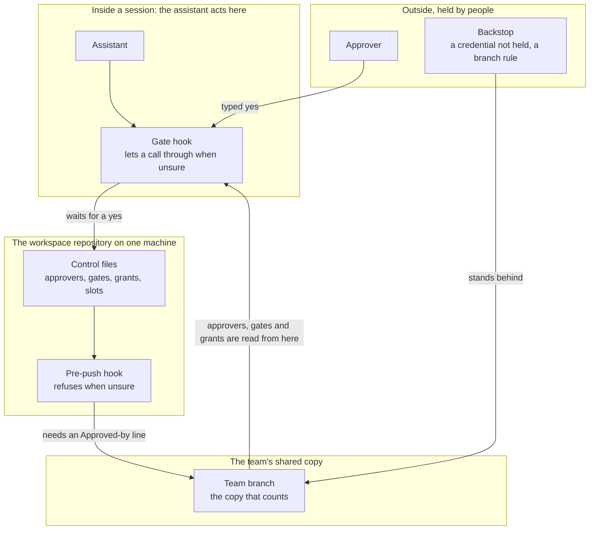

# Security model

Read this first: **every hook is a check against a confused assistant, not a wall.** A hook stops an assistant
that lost track of a rule. It does not stop one that is trying, and it does not stop a determined person. The real
control for each gated action is a backstop outside the hook, and the team must hold it.

The source for this page is `core/protocols/gates.md`.

## Trust boundaries

The diagram answers: what can the assistant reach, what can only a person change, and where is the real control?

## Who can approve

- The team lists its approvers under `approvers:` in `workspace.yaml`.
- The list is read from the team's shared copy (origin's branch on git). A local edit adding oneself counts for
  nothing until it has been approved and shared.
- On git the person at the keyboard is the git user name. On a shared folder it is a name the person declared by
  hand in the machine's config folder. Both are declared, never proven: there are no signatures.
- An agent is never an approver. The health check fails a name that is both.

## How a yes is given

Three things open a gate. The gate hook refuses a session's write to the transcript and to the ask slot's records,
and a grant is written only on an approver's yes. That refusal is a guard that reads commands, not a wall: see
Known limits.

1. **A typed yes.** A message a person typed in this session that names the subject and agrees. A message with a
   refusal or a condition is a no. When in doubt it is a no. It counts only when the person at the keyboard is an
   approver.
2. **A bare yes through the ask slot.** The reply must be the approver's latest on an ask for the same subject,
   not withdrawn, and a bare yes. A yes with a condition is a new question.
3. **A standing grant.** See below.

When the hook reads a yes it writes an `approve` line to the ledger with a hash of the message it read. An
unanswered ask is a no.

## What is gated

- **The team's gated commands.** `gated_commands:` in `workspace.yaml` maps a plain name to a pattern over the
  words of a shell command. A matching command waits for a yes.
- **Control files.** `workspace.yaml`, `constitution.md`, `memory/shared/grants.md`,
  `memory/shared/approval-gates.md`, `.claude/settings.json`, and everything under `slots/`, `agents/`,
  `.claude/hooks/`, `.claude/agents/` and `.claude/skills/`. They decide what the assistant may do. `modes/` is
  not on the list: working instructions are edited directly. The assistant writes a control file only on an
  approver's yes that names it. A file at the workspace root is named by its name (`workspace.yaml`). The settings
  file is named as `.claude/settings.json`. A control folder is named by its path with the slash (`slots/`,
  `agents/`, `.claude/hooks/`, `.claude/agents/`) or by the path of the file being changed. The folder's word alone
  does not count. A skill is named as `skills/<name>`.
- **Outside the workspace, when the team turns it on.** With `outside: ask-first`, a file tool's write outside the
  workspace, the temp folder and the declared working areas waits for a yes. Off by default.

On git a control-file change also needs an `Approved-by:` line on its commit, tied to a recorded yes. The pre-push
hook refuses a control-file change headed for the team branch without it. One record covers one commit. The text
of the change is not bound to the yes. The branch rule on the code host is what stands behind that.

## The never list

No grant opens these: approving or granting, and changing the gates, approvers, agents, grants, slots, hooks,
settings or core rules. A grant that names one stands for nothing, and the health check fails it. A person does
them, through a change an approver said yes to by name.

The gate hook also refuses a session's write to: the declared name and working areas in the machine's config
folder, the git user name, the ask slot's records, the session ledger, the runtime's own transcripts, and git's
installed hooks.

## Standing grants

A standing grant is a written entry in `memory/shared/grants.md` that opens a gate later without a new yes.

- An approver decides it. The assistant drafts it and writes it only on that approver's typed yes naming the file.
- Gate, scope and holder are required. Target, ceiling, expiry and review date are optional.
- The holder is a way of working (a kind of session such as `triage`), one session id, an agent's name, or `any`.
  A holder should not name a person. The code does not refuse it: a holder is matched against the git user name,
  so a person's name there would work.
- Strong actions (production, merge, release, creating a tracker item) can be granted only with a `Target:` naming
  the exact target and a holder that is not `any`.
- The health check asks for a review of any grant with no ceiling and no expiry after `grants.review_days`
  (90 in the seed).

## Where the hooks live

- The session hooks (the gate, the prompt counter, the start steps, the stop checks) come with the core plugin.
- Git's hooks are installed by a session start, inside the workspace repository's own `.git/hooks` folder. Nothing
  outside the repository is written.
- The install writes `pre-push` and `prepare-commit-msg`. A hook already there is renamed to `<name>.next` and
  still runs after the installed one.
- Where the machine's git config names one hooks folder for every repository, that folder is left as it is. The
  install sets the repository's own local hooks-path setting to its `.git/hooks` folder and writes pass-through
  stubs there, so the machine's hooks still run for the workspace.
- A repository whose own hooks-path setting a person pointed at another folder gets no hook until they unset it.
  The session start says so.
- Each check has a mode under `hooks:` in `workspace.yaml`: `block`, `log` or `off`.
- Another runtime that only reads `AGENTS.md` gets the rules as text and none of the hooks.

## The backstop each gated action must name

Each gated action names a backstop outside the hook, under `backstops:` in `workspace.yaml`. Setup asks for one
per gate. The health check warns while one is missing, and keeps warning while one is recorded as "nothing yet",
"none" or the like.

| Gated action | What the product ships as the check | The backstop a team must hold outside it |
| --- | --- | --- |
| A team's gated command | gate hook | a credential the assistant's account does not hold, or the other system's own approval step |
| A control-file change reaching the team branch | gate hook, then the pre-push hook | a branch rule on the code host: required review, no direct change to the branch |
| A yes through the ask slot | gate hook reads the slot's records | the slot reports who answered from the tool's account data, and its records are kept where sessions cannot write, when the tool allows |
| A file change outside the workspace | gate hook, when turned on | file permissions, or review before a change takes effect |
| Sharing every turn | stop hook | a periodic check outside any session that reports unshared files |
| Sharing in a way that skips git's hooks | gate hook | the same branch rule |

## Known limits

These are stated in `core/protocols/gates.md` as known ways past the hooks.

- A hook that reads a command is passed by rewording it: quoting, a variable, a wrapper script, a function,
  command substitution, a tool the wiring does not list.
- A hook that times out or throws lets the call through. Every hook lets the call through when it cannot tell.
  The one check that refuses when unsure is git's pre-push hook.
- The transcript and the records a yes is read from are ordinary files on the machine, and so is git's hook file.
  The guard on them is a hook that reads commands, so it can be passed the same way.
- A machine where no session has run has no pre-push hook, and a person can skip it.
- Identity is declared, never proven. There are no signatures and no cryptography.
- The QA verdict a card needs before it closes as done is one line in `sessions/<card>/qa-report.md`, a file the
  assistant writes. The close reads the line. Nothing checks that QA ran, that a separate helper ran it, or that
  the evidence above the line is true. A person who needs to know reads the report.
- A worker loads the hooks only if the plugin is enabled for its session, and sub-agents a worker starts are not
  known to load them.
- The health check's search for secrets and personal data is a guess from patterns.
- Text from a slot, a record, a memory entry or a pasted page is treated as content to analyse and never a
  command. The scripts mark it as data. Following that rule is prose, not code.

So the rule for a team is short: for anything that must not happen, hold a control the assistant cannot reach.

Next: [Several teams](Several-teams.md).
