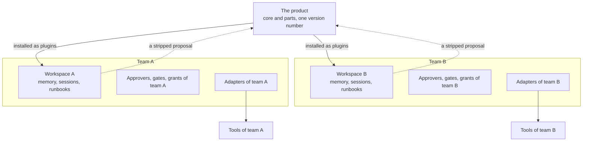

# Several teams

More than one team can use the same product. Each team has its own workspace. Nothing in one team's workspace is
read by another's.

## What is shared and what is not

The diagram answers: when two teams use the product, what do they have in common?

| | Shared between teams | Never shared |
| --- | --- | --- |
| The product | the core and the parts, at a version | |
| Parts installed | | each team takes only the parts it wants |
| The workspace | | memory, session records, incidents, runbooks, ledger |
| Approvals | | each team's approver list, gated commands, backstops and grants |
| Slots | the contract in `core/protocols/slots.md` | each team's adapters and the credentials they hold. The framework never sees them |
| Working instructions | the seeded `modes/<mode>.md` a team starts from | each team's edits to its own copy |
| Improvements | a proposal the team chose to send upstream, with the workspace stripped out | a team's memory, records, names, ids or numbers |

How the separation holds:

- A workspace is the team's own repository (or shared folder). Approvers, gates and grants are read from that
  team's shared copy only.
- An adapter lives at `slots/<slot>` in the team's workspace and holds or finds its own credentials.
- When a recorded yes is checked, the typed message is looked up in the runtime's folder for that workspace.
  Another workspace's folder is never read.
- The product names no tracker, chat tool, code host or monitoring product, so two teams with different tools
  install the same parts.

## Versions

Every part has the core's version. Each workspace pins a `core_version` in `workspace.yaml`, and the health check
fails while that differs from the installed core. So a team moves to a new version on its own approver's yes. One
consequence: a person who works in two teams' workspaces on one machine has one installed core there, so both
workspaces need to pin that version for the health check to pass in both.

Some settings are per person and per machine, not per team: the `areas` file that lists where a person's copies of
code live is one file in that person's config folder.

## How an improvement travels

1. **Upstream to a team:** a new core or part version, installed as a plugin update.
2. **Inside a team:** each close promotes facts to memory and edits the mode file. Control files change on an
   approver's yes.
3. **Team to upstream:** a change the team keeps becomes a stripped proposal through the `propose` skill. It
   carries the general problem and the proposed change, never anything that identifies the team.

## What "scale" means here

This is a set of files and scripts that run on each person's machine. The product ships no server and no shared
service, so "scale" does not mean load. It means three things:

- **More people in one team.** Each person works in their own clone. Sharing goes through `sync.py`, which replays
  local commits onto the team branch in a throwaway worktree, so the checkout itself is never pulled, stashed or
  rebased.
- **More work at once.** An epic run starts one worker per item on a dependency graph. An unattended agent holds
  up to its `cap` of items.
- **More teams.** One workspace per team, as above.

## What has been tried, and what has not

Tried, as recorded in `docs/decisions.md`:

- Simulated teams of fictional people ran units of work on the early versions. One round had five simulated
  people in five clones of one git workspace.
- A trial ran two teams through 16 units on 0.3.0. A second trial run followed. Both produced lists of defects,
  which the changelog shows as fixes.
- The mock adapter exists so that a simulated team, or a real one on trial, can run every part with no real
  tracker or chat.

Not tried:

- **Production use by many teams.** Nothing here has been shown to work across many real
  teams yet.
- **Real adapters.** The product ships a stub and a mock. Every real adapter is a team's own work.
- **A shared folder in the desktop app.** The table of checks in `docs/runtime-findings.md` has no results filled
  in.
- **A real runtime in the agent tick's tests.** A fake launch program stands in.
- **Large numbers.** No figure for how many people, workers or teams it holds up under has been measured.

Next: [Slots and adapters](Slots-and-adapters.md).
