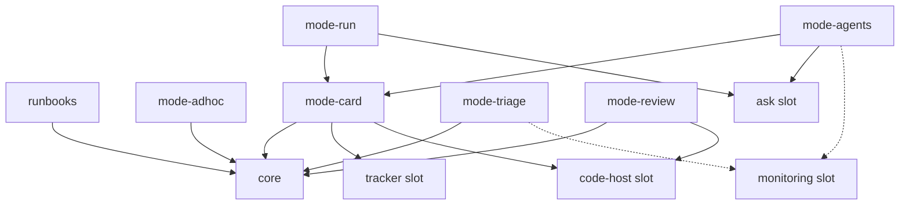

# The parts

A team installs the core and then any parts it wants. Each part lists what it needs. The source for this page is
`docs/parts.md` and the `module.md` file in each folder under `modules/`.

## What depends on what

The diagram answers: if I install a part, what else must be there? A solid arrow means "needs". A dotted arrow
means "optional, or needed for one feature only".



The diagram leaves out some arrows to stay readable. The table is complete.

| Part | Plugin name | Needs | What it adds |
| --- | --- | --- | --- |
| core | `trampo-core` | nothing | rules, hooks, protocols, setup, session, the health check, the slot runner and the mock adapters |
| runbooks | `trampo-runbooks` | core | system and flow runbooks, the first load from code, replay. No slot, no other mode |
| mode-adhoc | `trampo-mode-adhoc` | core | a session with a record, for work that is not a card or a triage |
| mode-card | `trampo-mode-card` | core, tracker slot, code-host slot to open and read the review | one work item from intake to done |
| mode-triage | `trampo-mode-triage` | core, monitoring slot optional | alarms and notices, and the support week |
| mode-review | `trampo-mode-review` | core, code-host slot | one change request reviewed read-only, with evidence rules checked in code |
| mode-run | `trampo-mode-run` | core, tracker, ask and code-host slots, mode-card | the controller and the readiness step |
| mode-agents | `trampo-mode-agents` | core, tracker, ask and code-host slots, monitoring for the release monitor, mode-card for the worker. The agent code calls only tracker and ask: the code-host slot is used by the card worker | card agent, agents monitor, release monitor, card triage |

Setup copies a stub into each slot. The stub answers exit status `3` to every verb, and the assistant then asks
the person to do the step and tell it the result. A team that chose the mock at setup can run a part against the
mock instead. A part never reaches an outside system except through a slot. See [Slots and adapters](Slots-and-adapters.md).

Every part has the same version as the core.

## Take only this

### Recipe 1: the core alone

You get the rules, the gates, the session record, the ledger, the memory layout, setup and the health check. You
get no mode, so no packaged way of running a kind of work.

```bash
claude plugin marketplace add trampo-framework/trampo
claude plugin install trampo-core@trampo
```

Then open an empty folder, run `/trampo-core:setup` and choose no modes. Check with `/trampo-core:doctor`.

### Recipe 2: the core plus runbooks

You get a place for what the team knows about its systems, and a first load that reads code and documents and
drafts runbooks. It needs no slot and no mode.

```bash
claude plugin marketplace add trampo-framework/trampo
claude plugin install trampo-core@trampo
claude plugin install trampo-runbooks@trampo
```

In an empty folder run `/trampo-core:setup` and choose no modes. Then run `/trampo-runbooks:first-load`.

What to know before you rely on it:

- The first load reads at a pinned commit and runs nothing against any system.
- A runbook written from reading is a draft. Reading code alone gets things wrong, so every traced step carries a
  stamp until a replay has run it.
- Replay is off by default. It needs a test environment, and turning it on changes `workspace.yaml`, which waits
  for an approver.

More in `modules/runbooks/README.md`.

### Recipe 3: the core plus person-run modes

You get sessions a person runs at the keyboard: ad-hoc work, one work item, and triage.

```bash
claude plugin marketplace add trampo-framework/trampo
claude plugin install trampo-core@trampo
claude plugin install trampo-mode-adhoc@trampo
claude plugin install trampo-mode-card@trampo
claude plugin install trampo-mode-triage@trampo
```

Run `/trampo-core:setup`, then `/trampo-mode-adhoc:adhoc`, `/trampo-mode-card:card` or
`/trampo-mode-triage:triage`. The card mode uses the tracker slot. Until the team fills it, the assistant asks
the person to do the step and tell it the result, unless the team chose the mock at setup. The card mode also
uses the code-host slot to open and read a review. The review mode
(`trampo-mode-review`) installs the same way and needs the code-host slot.

## What a mode is

A mode is a folder with one layout: a manifest (`module.md`), a thin skill, and a seeded file of working
instructions that setup copies into the workspace as `modes/<name>.md`. The team owns that file once it is copied
and edits it directly. It wins over the skill. A team can write its own mode: see `docs/writing-a-module.md`.

Next: [Adopting it](Adopting-it.md).
